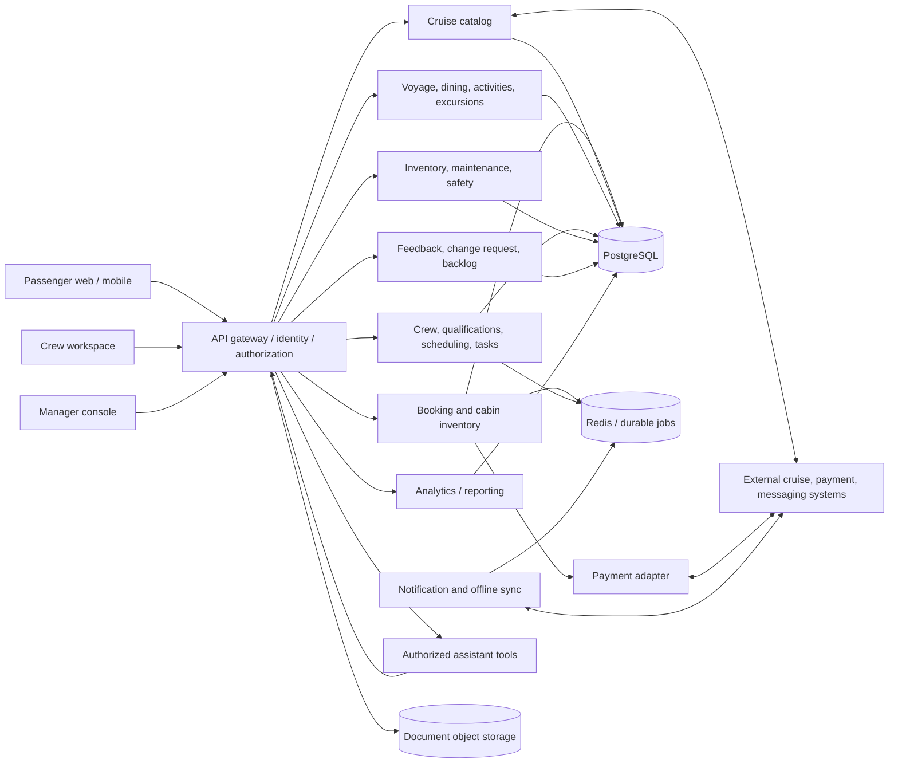
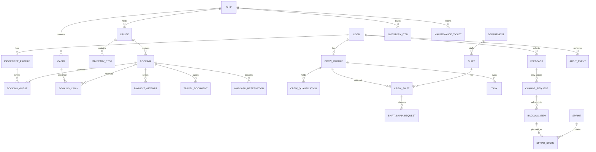
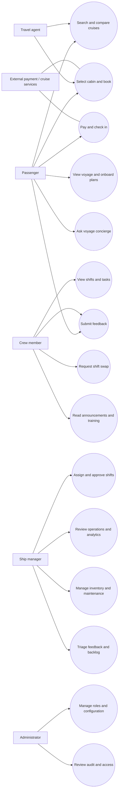
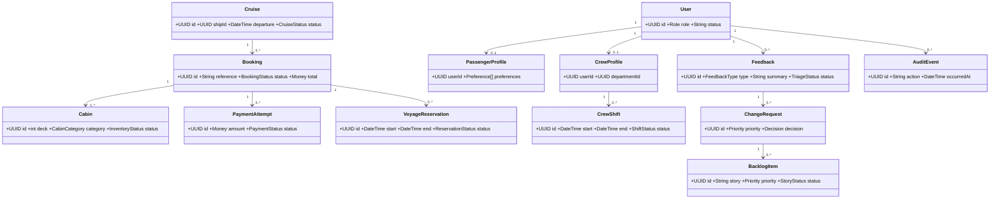
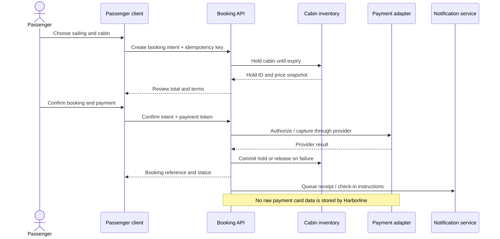
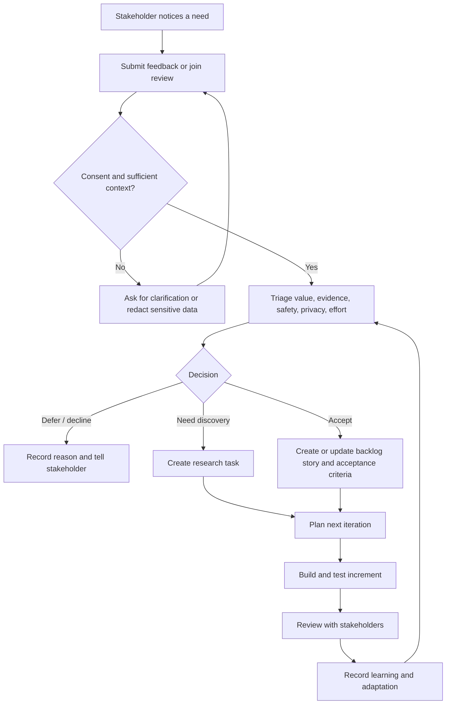

# Architecture, Data Model & Risk Register

## Status and architecture decisions

The current local MVP is a same-origin HTML/CSS/JavaScript client served by a Node.js HTTP server. The server exposes authenticated JSON APIs and stores demo accounts, sessions, sailings, cabin inventory, bookings, onboard requests, feedback, crew workflows, and manager operations in SQLite (`data/harborline.sqlite`). Passwords use scrypt hashes; sessions use random tokens stored by hash in HttpOnly, SameSite cookies. Authorization is checked on API routes by role and account ownership. Development demo accounts are seeded only outside production.

This is an academic local build, not an operator-connected or production system. Records are seeded sample data. Cabin booking is atomic and idempotent for the demo, but it collects no payment and does not create a valid travel credential. Production identity, email delivery, operator data adapters, payment, audit retention, backups, deployment controls, and independent security review remain future work. The technology direction below is the proposed evolution path for those requirements.

### Current implementation slice

| Area | Local implementation | Boundary |
|---|---|---|
| Identity | Passenger registration, sign-in/out, password reset token flow, role-scoped demo accounts | Reset token is printed to the local server terminal; no email or operator identity provider. |
| Persistence | SQLite schema and seed data; authenticated API routes | One local database file; no production migration, backup, or multi-instance strategy. |
| Booking | Cabin availability, idempotent reservation, passenger booking list, check-in state | Demo reservation only; no payment, fare rules, or real cruise inventory. |
| Onboard | Saved dining/activity requests and passenger feedback | Seeded catalog and no external capacity system. |
| Crew | Tasks, attendance, shifts, swap requests and manager decisions | Seeded schedules and no qualification, labor-rule, or HR integration. |
| Management | Operations summary, feedback triage, maintenance tickets, CSV report | Sample operational values; no connected vessel system or audit retention. |

The diagrams and normalized model below describe the target architecture and design considerations, not the current SQLite schema.

### Proposed technology direction

| Concern | Candidate | Why / decision still needed |
|---|---|---|
| Web client | Next.js + React + TypeScript + accessible design system | Supports role-specific, responsive views and reusable modules. The prototype is framework-free to keep initial exploration fast. |
| API | Node.js + TypeScript REST API; WebSockets only for genuinely live updates | Versioned modules and replaceable service adapters. Confirm hosting, auth, and vessel connectivity first. |
| Persistence | PostgreSQL with Prisma or equivalent migrations | Relational booking, inventory, schedule, and audit data. Confirm fleet system of record and consistency needs. |
| Cache / jobs | Redis and a durable worker queue where justified | Reservations, notifications, and synchronization may need asynchronous processing. Select after load and failure analysis. |
| Storage | S3-compatible object storage | For consented passenger documents and controlled operational attachments, with retention and encryption. |
| Deployment | Containerized services behind a managed ingress/reverse proxy | Environment parity and replaceable deployment units. Production topology depends on operator and connectivity requirements. |
| Payments | Provider adapter; tokenization / hosted payment elements | Avoid storing card data. Pick a provider only after jurisdiction and procurement review. |

## Architectural principles

1. **Modular boundaries:** Passenger Identity/Profile; Cruise Catalog; Cabin Inventory; Booking; Payment; Voyage/Onboard Services; Crew/Qualifications/Scheduling; Ship Operations; Feedback/Backlog; Notification; Analytics; Assistant.
2. **API-first contracts:** schemas are versioned; modules publish events or stable interfaces instead of directly mutating another module's tables.
3. **Replaceable integrations:** provider-specific code sits behind payment, messaging, maps, document storage, and cruise inventory adapters.
4. **Role and scope before data:** authenticate the actor, resolve their ship/booking scope, authorize the action, then fetch only permitted fields.
5. **Audit consequential changes:** booking and payment transitions, shift approvals, maintenance status, inventory adjustments, access to sensitive records, and assistant tool use are attributable.
6. **Human authority for operations:** recommendations support authorized staff; they cannot approve safety-critical or staffing decisions on a person's behalf.
7. **Offline aware:** clearly label cached data freshness; queue safe writes only when idempotency and conflict rules are defined.
8. **Learnable seams:** changing a fare rule, itinerary source, or scheduling constraint should not require a rewrite of unrelated passenger or ship operations modules.

## Context and proposed component diagram

The assistant calls the same authorized domain services as a user interface. It does not receive database credentials or bypass row/field authorization. Its responses should name source and freshness, and refuse when permission or evidence is missing.

## Proposed relational model

This logical model is a starting point for design review. Normalize operational records where transactions and auditability require it; do not expose internal keys as public boarding credentials.

### Entity notes

- `USER`: identity subject, enabled status, authentication reference. Passwords belong to an identity provider or a purpose-built secure identity service; never store plain text.
- `PASSENGER_PROFILE`: preference controls and consent metadata. Minimize sensitive attributes; retention and deletion follow policy.
- `CREW_PROFILE`, `CREW_QUALIFICATION`, `DEPARTMENT`: employment and qualification scope. Access limited to authorized crew/management functions.
- `SHIP`, `CRUISE`, `ITINERARY_STOP`: versioned operational catalog, source and last-updated timestamp for sailing facts.
- `CABIN`: ship, deck, category, accessibility attributes, inventory status. Availability is time-bound and must be reserved atomically.
- `BOOKING`, `BOOKING_GUEST`, `BOOKING_CABIN`: booking state machine and guest/cabin links. Use transactions and idempotency keys on reservation and payment operations.
- `PAYMENT_ATTEMPT`: provider reference, amount/currency, status, and reconciliation metadata; no card number or security code.
- `TRAVEL_DOCUMENT`: private object reference, classification, retention, and access audit.
- `ONBOARD_RESERVATION`: event/resource, guest, time-zone-aware interval, capacity, and cancellation status.
- `SHIFT`, `CREW_SHIFT`, `SHIFT_SWAP_REQUEST`, `TASK`: qualified assignment, rest validation, manager approval, and auditable state transitions.
- `INVENTORY_ITEM`, `MAINTENANCE_TICKET`: ship/dept source-of-truth integration, count/freshness, priority, owner, and lifecycle.
- `FEEDBACK`, `CHANGE_REQUEST`, `BACKLOG_ITEM`, `SPRINT`, `SPRINT_STORY`: traceability from consented feedback to decision and sprint review. Store a redacted summary if free text includes personal data.
- `AUDIT_EVENT`: actor, action, object, reason, event time, request/correlation ID. Append-only policy and retention are to be confirmed.

## Use-case diagram

## Class diagram (simplified)

## Booking sequence (proposed)

## Feedback-to-adaptation activity diagram

## Security boundaries and authorization

| Role | Example permitted scope | Explicit boundary |
|---|---|---|
| Passenger | Own profile, booking guests, own itinerary, own feedback | Cannot query other passenger records or crew/ship personnel data. |
| Crew member | Own shifts/tasks/qualifications; authorized team notices | Cannot change published schedule or read unrelated passenger documents. |
| Department lead / manager | Assigned ship and department operations, approved metrics, triage queue | Scope constrained to assigned vessel/department; audited override required. |
| Captain / safety role | Vessel readiness and safety workflows defined by operator | Safety data freshness and command authority are explicit; no automated final decisions. |
| Travel agent | Client bookings covered by a current delegation/contract | No access beyond assigned travelers, itinerary facts, and permitted booking actions. |
| Administrator | Identity/configuration and system audit functions | Administrative access is separated from routine guest operations and audited. |

Authorization should be enforced server-side on every request; hiding a UI control is not authorization. The assistant's tool calls use the actor's current permissions and return the minimum fields needed.

## Risk register

Probability and impact are qualitative initial assessments; review them with the operator and at each sprint.

| ID / risk | Probability | Impact | Response / trigger |
|---|---|---|---|
| R-01 Payment failure or duplicate charge | Medium | High | Payment abstraction; idempotency; provider reconciliation; test retries/refunds. Review before Sprint 4. |
| R-02 Intermittent onboard internet | High | High | Discover offline work in Sprint 0; define cached read views, freshness markers, safe write queue, and conflict resolution before rollout. |
| R-03 Requirements change after discovery | High | Medium | Keep backlog mutable; preserve change rationale and acceptance criteria; reserve sprint capacity for adaptation. Review each sprint. |
| R-04 Crew scheduling conflict, qualification gap, or rest-rule breach | Medium | High | Encode validated constraints; highlight conflicts; retain manager approval and override reason; involve crew/HR/safety before Sprint 6. |
| R-05 Peak passenger load degrades search or booking | Medium | High | Define workload profile; load-test inventory holds and idempotency; use caching only where staleness is safe. Before production booking. |
| R-06 Cabin inventory becomes stale or two guests receive one cabin | Medium | High | Inventory system of record, expiring atomic holds, transaction/idempotency tests, explicit unavailable state. Sprint 3/production gate. |
| R-07 Private passenger/crew data appears in feedback or assistant output | Medium | High | Data minimization, redaction, consent, role-scoped retrieval, audit, privacy/security review and adversarial tests. Before external pilot. |
| R-08 Sample figures are mistaken for real operational status | Medium | High | Persistent sample-data labels, source/freshness metadata, no operational decisions from prototype. Review before every demo. |
| R-09 Itinerary changes due to weather or port operations | High | Medium | Source timestamp, change notifications, traveler acknowledgement rules, human operator override. Sprint 5. |
| R-10 QR pass is copied, forged, or shown after booking revocation | Low/Medium | High | Signed expiring credential, scan validation, offline revocation strategy, minimum PII. Sprint 4 security review. |
| R-11 Assistant gives unsupported or unauthorized advice | Medium | High | Retrieval through authorized tools; source citations and freshness; abstain/escalate; role tests; no autonomous transactions. Sprint 10. |
| R-12 Different vessel systems disagree about source of truth | Medium | High | Map integration ownership and reconciliation in discovery; adapters, correlation IDs, timestamps, and exception queue. Sprint 0/8. |

### Risk review cadence

At planning, review open risk owners, triggers, mitigations, and newly introduced dependencies. At review/retro, note incidents, near misses, changed probability/impact, and whether an adaptation is needed. Escalate safety, payment, privacy, or security risks immediately through the operator's governance process; a backlog ranking does not replace required approvals.

## Architecture decision record (initial)

**ADR-001 — Modular, API-first direction.**

- **Status:** proposed; validate in Sprint 0 before adopting for production.
- **Context:** booking, onboard experience, crew, and operations change at different rates and may rely on existing operator systems.
- **Decision:** establish domain boundaries and versioned APIs; begin with a modular application and separate adapters. Defer microservice decomposition until scale, team ownership, or reliability evidence justifies it.
- **Consequences:** clearer seams and test contracts; requires disciplined API/schema changes and integration monitoring. The current app uses a single Node server and SQLite database, with modular API handlers rather than independently deployed services.
- **Revisit when:** deployment boundaries, team ownership, availability targets, vessel connectivity, or load evidence materially changes.
